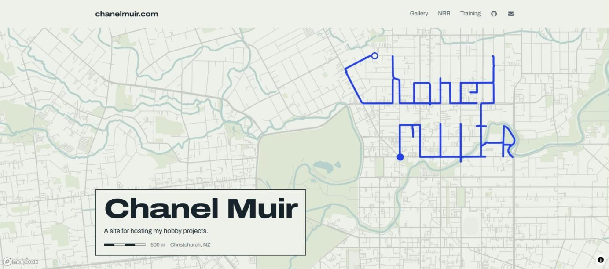

# chanelmuir.com

My personal site, and a home for the things I build for fun. Most of them end up involving running and maps.

[](https://chanelmuir.com)

The run on the homepage is real. It's a 13.6 km run through central Christchurch, drawn exactly as my watch recorded it.

## What's on it

- **[Projects](https://chanelmuir.com)**: a page for each thing I've made, like [SleeveMap](https://sleevemap.chanelmuir.com/) (every street I've ever run, on one map) and a Chrome extension that blocks a site but keeps the useful pages open.
- **[Training](https://chanelmuir.com/training)**: every run since about 2018. Every route is drawn on one map, with charts for distance, pace and the year so far. A daily job pulls new runs from my watch and keeps it up to date.
- **[NRR](https://chanelmuir.com/nrr)**: the 2026 NZ Road Relay, with course maps, leg splits and how each team's position changed over the day.
- **[Gallery](https://chanelmuir.com/gallery)**: a guessing game. You get one of my photos and drop a pin where you think it was taken.

## Built with

Next.js, Tailwind, Mapbox GL and Supabase, hosted on Vercel.

## Running it locally

```bash
npm install
npm run dev
```

Then open [localhost:3000](http://localhost:3000). Pages that use a map or the gallery need these in `.env.local`:

| Variable | Used for |
| --- | --- |
| `NEXT_PUBLIC_MAPBOX_TOKEN` | All the maps |
| `NEXT_PUBLIC_SUPABASE_URL`, `NEXT_PUBLIC_SUPABASE_ANON_KEY` | Gallery photos |
| `SUPABASE_SERVICE_ROLE_KEY`, `ADMIN_UPLOAD_PASSWORD` | Uploading gallery photos at `/admin/gallery-upload` |

## Where things live

```
app/                 pages (one folder per route: training, nrr, gallery, projects, ...)
content/projects/    the write-up for each project, in Markdown
content/posts/       longer posts
scripts/             build-training-data.py, which turns Strava and COROS exports into the /training data
public/              images
```

Adding a project is a new Markdown file in `content/projects/`. It gets its own page and a card on the homepage.
